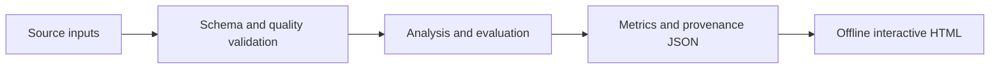

# Architecture and engineering decisions

**Project flow:** Historical CSV --> duplicate + financial-quality checks --> explicit cohort --> sensitivity + paired bootstrap --> interactive evidence report.

## Design decisions

### Keep the denominator visible
The pipeline removes exact duplicates, then requires finite analysis values and positive budget, revenue and runtime. Every retained percentage uses the deduplicated source denominator. Coverage by decade exposes where financial availability differs.

### Separate uncertainty from selection
Paired-record percentile bootstrap intervals preserve each movie’s feature/revenue pairing. They measure uncertainty conditional on the cohort; they are not a correction for missing finances, franchise dependence or post-release information.

### Recompute under alternative cohorts
The same relationships are recomputed after a vote-count threshold, upper-tail exclusions and a minimum financial floor. Each view reports its own cohort size and interval, rather than reusing the main-cohort uncertainty.

## Failure behavior

Schema errors, invalid analysis inputs and insufficient cohorts fail with an explicit command-line error and a nonzero exit status. Results serialize as strict JSON; non-finite values cannot silently enter the report. The HTML renderer escapes embedded JSON and writes chart labels as text. Reports make no external script, analytics or data requests.

## Source layout

- `src/movie_finance/` contains the implementation and report renderer.
- `tests/` covers data/model invariants and report consistency.
- `docs/` contains a generated real-data report and its machine-readable results.
- `.github/workflows/ci.yml` runs checks on Python 3.11 and 3.12.

## Public artifacts

Raw restricted datasets are never embedded in the reports. Public outputs contain analytical aggregates and source fingerprints. Input filenames appear in the reproducibility record; local directories do not. Source/provider terms are documented separately in `DATA.md`.
