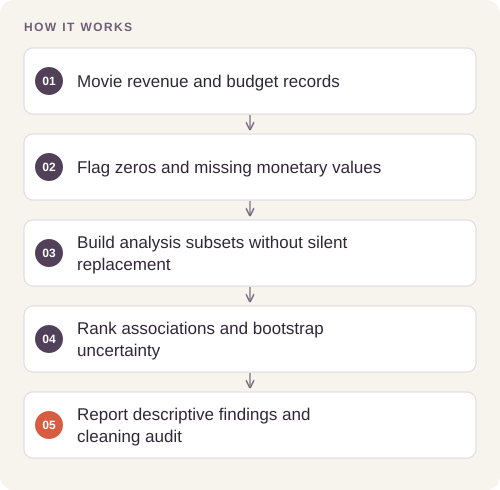
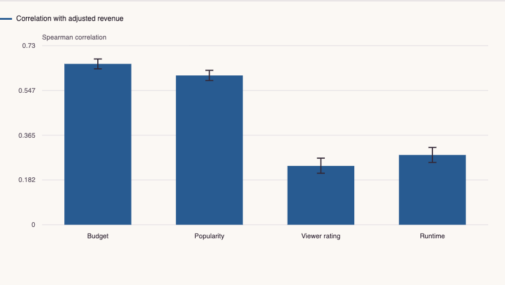

# Movie Revenue: Selection, Sensitivity & Uncertainty

A financial-data investigation that makes cohort coverage, missing-value treatment and sensitivity visible alongside the headline correlations.

**[Open the interactive report](https://feraselghandour.github.io/movie-revenue-analysis/)** · [Architecture](ARCHITECTURE.md) · [Methods and validation](VALIDATION.md)

[](https://github.com/FerasElghandour/movie-revenue-analysis/actions/workflows/ci.yml)

## How it works



## Try a small example

A small offline fixture exercises the public implementation. It demonstrates the behavior shown below; it does not replace the historical dataset, benchmark or production validation.

After the local setup below, run from the repository root:

```sh
python examples/quickstart.py
```

The [example source](examples/quickstart.py), [captured output](examples/expected-output.txt) and [execution record](examples/environment.json) keep this demonstration inspectable. Floating-point values may vary with library versions.

Observed output from this run:

```text
{
  "fixture": "generated linear relationship, not movie evidence",
  "audit": {
    "input_rows": 16,
    "exact_duplicates_removed": 0,
    "deduplicated_rows": 16,
    "usable_rows": 15,
    "retained_percent": 93.75
  },
  "rank": {
    "rho": 1.0,
    "ci95": [
      0.9999999999999998,
      1.0
    ]
  }
}
```

## What the evidence shows

Budget and popularity have the strongest revenue associations in the usable cohort. The analysis also shows why **3,854 usable records out of 10,865 distinct records** cannot be treated as a representative sample of all movies.

| Measure | Result |
|---|---|
| Source records | 10,866 |
| Usable financial cohort | 3,854 records; 35.47% retained |
| Budget–revenue Spearman correlation | 0.656; 95% interval 0.635–0.676 |
| Popularity–revenue Spearman correlation | 0.608; 95% interval 0.588–0.629 |
| Sensitivity analysis | Four cohort definitions; 1,000 bootstrap draws per estimate |

The interactive report includes selectable comparisons, a matching numerical table, CSV/JSON downloads and the reproducibility record. It also works offline: download `docs/index.html` and open it in a browser.

[](https://feraselghandour.github.io/movie-revenue-analysis/)

## Engineering

- An explicit financial-cohort quality gate and coverage audit by release decade.
- Paired-record bootstrap intervals for each relationship.
- Recomputed correlations under vote-count, upper-tail and minimum-financial-value filters.
- An interactive view that compares the result and its uncertainty across cohort definitions.

The analysis is packaged under `src/movie_finance/`; notebooks remain available for the longer exploratory narrative. Small root-level entry points preserve existing commands.

## Reproduce

Use Python 3.11 or later and a separate virtual environment for this repository.

```sh
python -m venv .venv
. .venv/bin/activate
python -m pip install -e ".[dev]"
python -m movie_finance --input /path/to/tmdb-movies.csv --output reports
python -m pytest -q
```

Use the historical extract described in [DATA.md](DATA.md). Current API exports are not interchangeable with it. The public report contains aggregate statistics, without movie-level text or records.

Each run writes `index.html` and `metrics.json` to the chosen output directory. The JSON records the measured results, input SHA-256 fingerprints, source-code fingerprints, dependency versions and analytical settings. To use the notebooks, install the optional `notebooks` dependencies.

## Interpretation

The intervals quantify within-cohort sampling uncertainty; they do not fix selection bias or dependence between related films. Audience measures have unspecified observation dates and may be post-release. Revenue is not profit, and this analysis is not a pre-release prediction model.

## Portfolio

- [Weather-Aware Bike-Share Demand Analysis](https://github.com/FerasElghandour/bikeshare-weather-analysis)
- [Bike-Share Customer Behavior](https://github.com/FerasElghandour/bikeshare-customer-behavior)
- [Shared-Policy Continuous Control](https://github.com/FerasElghandour/tennis-reinforcement-learning)

---

**Feras Elghandour** · [GitHub](https://github.com/FerasElghandour)  
Data sources and applicable license notices: [DATA.md](DATA.md).
