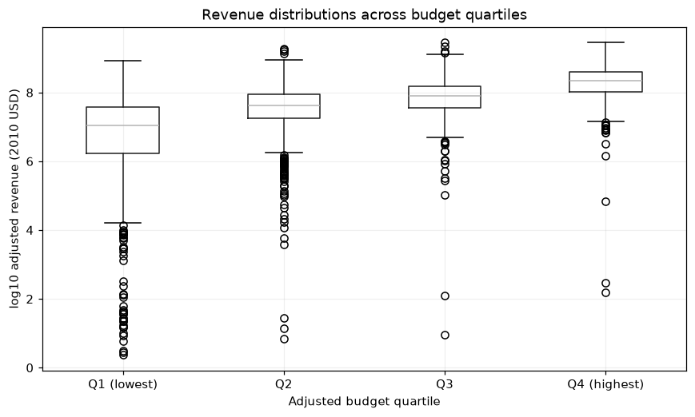

# Movie Revenue Analysis

Which movie characteristics are associated with higher revenue, and how much does incomplete financial reporting shape the result? This project analyzes historical movie records and makes the sample-selection tradeoffs explicit.

**Python · pandas · NumPy · Matplotlib**



## Results

| Measure | Result |
|---|---|
| Source records / release years | 10,866 / 1960–2015 |
| Budget–revenue rank correlation | 0.656 |
| Popularity–revenue rank correlation | 0.608 |
| Rating / runtime–revenue rank correlation | 0.240 / 0.284 |
| Usable share of deduplicated records | 35.47% |

## Implementation

- Inspected duplicate records, zero financial values, missingness and cohort coverage before analysis.
- Compared distributions and Spearman correlations for adjusted budget, popularity, rating and runtime.
- Examined revenue distributions across budget quartiles and checked alternative sample definitions.
- Documented selection effects and distinguished reported revenue from profitability.

## Practical relevance

Demonstrates disciplined financial-data exploration: defining a usable cohort, testing the sensitivity of a conclusion and communicating what the evidence supports. The workflow is relevant to commercial research and reporting with incomplete observational data.

## Explore the project

- `Investigate_a_Dataset.ipynb` — assessment, cleaning, visual analysis and sensitivity checks.
- `DATA.md` — required historical input and source details.

## Run locally

```sh
python -m venv .venv
. .venv/bin/activate
python -m pip install -r requirements.txt
jupyter lab
```

Supply the historical `tmdb-movies.csv` as described in `DATA.md`. Run `Investigate_a_Dataset.ipynb` from the repository root.

See [DATA.md](DATA.md) for required inputs and [VALIDATION.md](VALIDATION.md) for the checks and runtime versions.

## Scope

The comparisons are descriptive. Audience measures have unspecified collection dates, zero financial values have uncertain meaning, and the usable cohort is selective. Revenue excludes the cost information needed to assess profit.

---

**Feras Elghandour** · [GitHub](https://github.com/FerasElghandour)  
[Attribution and development notes](ATTRIBUTION.md)
